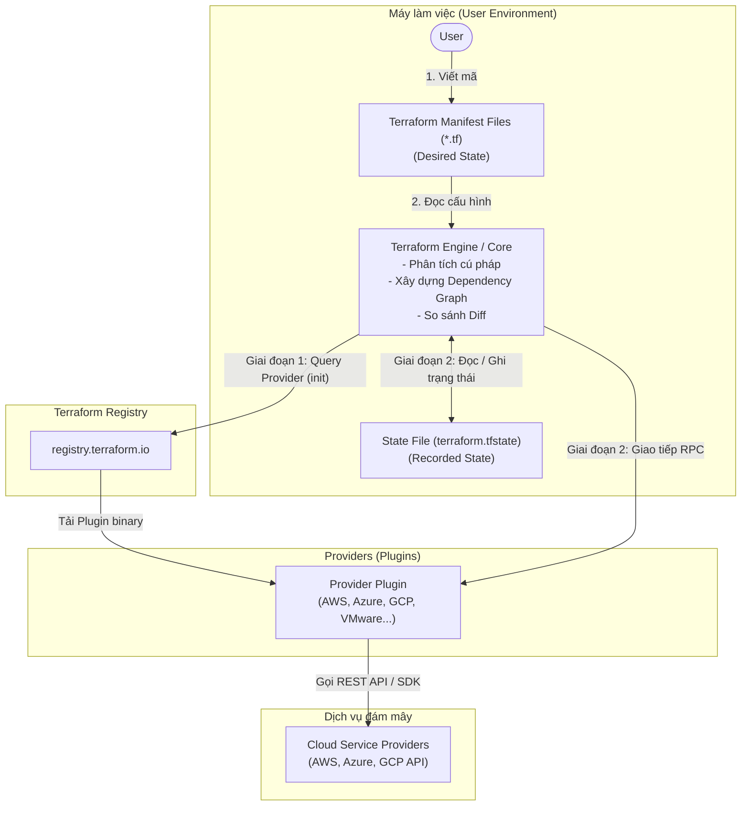
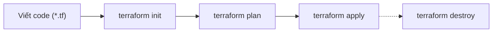
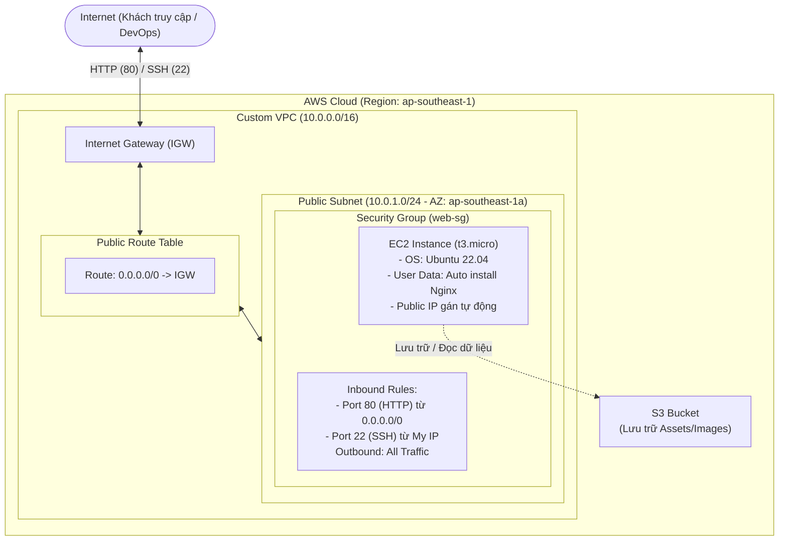

## 1. Cơ sở hình thành Terraform (Why IaC?)

### Các vấn đề thường gặp trong môi trường thực tế khi dùng AWS Console ("ClickOps")
Trong thực tế, khi mới tiếp cận điện toán đám mây (Cloud), đa số kỹ sư đều thao tác cấu hình thông qua giao diện Web (AWS Management Console / Azure Portal / GCP Console). Cách tiếp cận này được gọi vui là **"ClickOps"**, và nó nhanh chóng bộc lộ các nhược điểm nghiêm trọng khi hệ thống lớn lên:

1. **Khó tái lập (Non-reproducible)**:
   - Khi cần tạo một môi trường Staging giống hệt Production, việc click tay hàng chục dịch vụ (VPC, Subnet, EC2, RDS, IAM, S3) gần như chắc chắn sẽ dẫn đến thiếu sót hoặc lệch thông số cấu hình.
2. **Dễ mắc lỗi con người (Human Errors)**:
   - Một cú click nhầm Security Group mở port `0.0.0.0/0`, gõ nhầm CIDR block, hoặc quên bật tính năng backup có thể gây thảm họa bảo mật và gián đoạn dịch vụ.
3. **Không kiểm soát được phiên bản (Lack of Version Control & Audit)**:
   - Không có lịch sử lưu vết rõ ràng: Ai đã đổi cấu hình gì? Đổi lúc mấy giờ? Vì sao đổi? Nếu hệ thống bị sập sau khi đổi thì rollback (khôi phục trạng thái cũ) như thế nào?
4. **Tốc độ chậm & Khó mở rộng (Slow & Hard to Scale)**:
   - Triển khai thủ công cho 1 cụm server có thể mất nửa ngày; nếu cần nhân bản ra 10 regions trên toàn cầu thì đó là cơn ác mộng.
5. **Độ lệch cấu hình (Configuration Drift)**:
   - Sau vài tháng vận hành, cấu hình thực tế trên Cloud không còn khớp với tài liệu kiến trúc (Architecture Diagram) ban đầu do có nhiều người cùng vào "sửa nóng" trực tiếp trên console.

> [!IMPORTANT]
> **Giải pháp: Infrastructure as Code (IaC) - Hạ tầng dưới dạng mã nguồn**  
> IaC là phương pháp quản lý, cung cấp và cấu hình tài nguyên hạ tầng bằng các tệp mã nguồn (code) có thể đọc hiểu bởi cả con người và máy móc, thay vì bấm chuột thủ công. Hạ tầng giờ đây được quản lý bằng Git: có review code (Pull Request), kiểm thử tự động (CI/CD), và rollback tức thì.

---

### So sánh Declarative (Khai báo) vs Imperative (Mệnh lệnh)

Khi tiếp cận IaC hoặc các công cụ tự động hóa, có 2 trường phái tư duy thiết kế cốt lõi:

| Tiêu chí | Declarative (Khai báo - VD: Terraform) | Imperative (Mệnh lệnh - VD: Bash, Python Boto3, AWS CLI) |
| :--- | :--- | :--- |
| **Mindset / Trọng tâm** | **Tập trung vào "CÁI GÌ" (WHAT)**: Khai báo trạng thái đích mong muốn của hệ thống. | **Tập trung vào "LÀM THẾ NÀO" (HOW)**: Viết từng câu lệnh chỉ định các bước tuần tự để đạt kết quả. |
| **Ví dụ tư duy** | *"Tôi muốn có 3 máy chủ Ubuntu t3.micro chạy Nginx."* | *"Bước 1: Check xem có máy nào chưa. Bước 2: Tạo máy 1. Bước 3: Tạo máy 2..."* |
| **Quản lý Trạng thái (State)** | Tự động theo dõi trạng thái hiện tại (State file) và tự tính toán sự khác biệt (Diff). | Lập trình viên phải tự viết mã kiểm tra trạng thái (if/else), dễ bị trùng lặp tài nguyên. |
| **Tính Idempotency (Bất biến)** | **Rất cao (Built-in)**: Chạy lại code 10 lần vẫn chỉ giữ đúng số lượng tài nguyên như đã khai báo. | Khó đảm bảo: Nếu không viết logic kiểm tra kỹ, chạy script lần 2 có thể tạo thêm tài nguyên thừa. |
| **Công cụ / Ngôn ngữ tiêu biểu** | **Terraform (HCL)**, Kubernetes Manifest (YAML), AWS CloudFormation. | Bash scripts, Python SDK (Boto3), Ansible (pha trộn nhưng thiên về procedural tasks). |
| **Bảo trì & Sửa đổi logic** | **Đơn giản**: Muốn tăng từ 3 lên 5 máy? Chỉ cần đổi `count = 5`, công cụ tự biết tạo thêm 2 máy mới. | **Phức tạp**: Phải viết code tính số máy hiện có, trừ đi rồi mới gọi hàm tạo thêm. |

---

## 2. Giới thiệu về Terraform

### Terraform là gì?
- **Terraform** là một công cụ **Infrastructure as Code (IaC)** mã nguồn mở phổ biến nhất thế giới hiện nay, được phát triển bởi **HashiCorp** (ra mắt lần đầu năm 2014).
- Terraform cho phép kỹ sư định nghĩa, cung cấp (provisioning) và quản lý hạ tầng Cloud (AWS, GCP, Azure...) cũng như On-Premise và các dịch vụ SaaS (GitHub, Cloudflare, Datadog...) bằng một ngôn ngữ cấu hình có cấu trúc rõ ràng gọi là **HCL (HashiCorp Configuration Language)**.
- *Ghi chú bổ sung*: Năm 2023, HashiCorp chuyển giấy phép từ Mozilla Public License sang BSL. Từ sự kiện này, cộng đồng mã nguồn mở đã tạo ra bản fork hoàn toàn mở mang tên **OpenTofu** (được bảo trợ bởi Linux Foundation), có cú pháp và cách hoạt động tương thích 100% với Terraform.

### Các lợi ích then chốt của Terraform
1. **Độc lập nền tảng (Platform-Agnostic / Multi-Cloud)**:
   - Thay vì phải học CloudFormation (chỉ chạy AWS) hay ARM Templates (chỉ chạy Azure), bạn chỉ cần học một cú pháp HCL và một workflow Terraform duy nhất để làm việc với bất kỳ nhà cung cấp nào.
2. **Quản lý State thông minh (State Management)**:
   - Terraform lưu lại "bản chụp" (snapshot) của toàn bộ hạ tầng vào một file state (`terraform.tfstate`). Nhờ đó, Terraform luôn biết tài nguyên nào đã tạo, tài nguyên nào bị xóa, và chỉ cập nhật những gì thay đổi.
3. **Tự động xây dựng đồ thị phụ thuộc (Dependency Graph)**:
   - Terraform tự động phân tích quan hệ giữa các tài nguyên (ví dụ: EC2 cần Subnet ID, Subnet cần VPC ID). Nó sẽ tự sắp xếp thứ tự: tạo VPC trước, Subnet sau, và song song hóa (parallelism) những tài nguyên độc lập để tăng tốc độ khởi tạo.
4. **Hệ sinh thái Provider khổng lồ (Terraform Registry)**:
   - Hàng nghìn Providers và Modules có sẵn được cung cấp bởi chính AWS, Google, Microsoft và cộng đồng, giúp bạn tái sử dụng giải pháp mà không cần viết lại từ đầu.
5. **An toàn với tính năng "Xem trước thay đổi" (Execution Plan)**:
   - Trước khi áp dụng bất kỳ thay đổi nào lên môi trường thật, Terraform luôn cho phép xem trước chi tiết (Dry-run) những gì sẽ được thêm mới, cập nhật hoặc xóa thông qua lệnh `terraform plan`.

---

## 3. Cách hoạt động của Terraform

### Luồng hoạt động tổng thể (Terraform Architecture & Engine)



#### Chi tiết 2 giai đoạn hoạt động cốt lõi:

##### Giai đoạn 1: Khởi tạo môi trường (`terraform init`)
1. **User $\rightarrow$ Manifest files (`.tf`)**: Kỹ sư khai báo cấu hình hạ tầng mong muốn bằng ngôn ngữ HCL trong các tệp `.tf`.
2. **Manifest files $\rightarrow$ Terraform engine**: Terraform Engine quét và đọc mã nguồn, phân tích cú pháp để xác định các provider cần thiết (như AWS, Azure, GCP...).
3. **Terraform engine $\rightarrow$ Terraform Registry**: Engine chủ động gửi yêu cầu (request) lên kho lưu trữ trực tuyến **Terraform Registry** (`registry.terraform.io`) để tìm đúng phiên bản provider đã chỉ định.
4. **Terraform Registry $\rightarrow$ Provider**: Registry phản hồi và tải gói plugin binary của Provider về máy cục bộ, lưu trữ trong thư mục ẩn `.terraform/providers/`.

##### Giai đoạn 2: Lập kế hoạch & Thực thi (`terraform plan` / `terraform apply`)
1. **Tương tác 2 chiều với State file (`terraform.tfstate`)**:
   - **Chiều đọc (Read)**: Engine đọc file state để nắm được trạng thái đã ghi nhận ở lần chạy gần nhất (`Recorded State`).
   - **Chiều ghi (Write)**: Sau khi hạ tầng được tạo/cập nhật xong trên Cloud, Engine cập nhật thông tin và thuộc tính mới nhất vào file state.
2. **Terraform engine $\rightarrow$ Provider**:
   - Engine so sánh sự khác biệt giữa 3 trạng thái: *Code mong muốn (Desired State)* vs *Thực tế trên Cloud (Actual State)* vs *Đã ghi nhận (Recorded State)* để lên kế hoạch thay đổi (Execution Plan).
   - Engine điều phối và gửi các lệnh thực thi đến **Provider Plugin** thông qua giao thức RPC/gRPC nội bộ.
3. **Provider $\rightarrow$ Cloud Service Providers (AWS, Azure, GCP...)**:
   - **Provider đóng vai trò là "thông dịch viên"**: Nhận chỉ thị HCL từ Engine và chuyển đổi thành các lệnh gọi **REST API / SDK chính thức** (ví dụ: `ec2:RunInstances`, `s3:CreateBucket`...) gửi tới các nhà cung cấp đám mây tương ứng.
   - Các dịch vụ Cloud tiếp nhận API, khởi tạo tài nguyên thật và phản hồi kết quả về cho Terraform.

#### Quá trình 3 bước so sánh trạng thái:
1. **Desired State (Trạng thái mong muốn)**: Những gì bạn viết trong file `.tf`.
2. **Current State (Trạng thái thực tế)**: Những gì đang thực sự chạy trên AWS.
3. **Recorded State (Trạng thái ghi nhận)**: Những gì được ghi trong file `terraform.tfstate`.

=> **Terraform Core** so sánh `Desired State` với `Current State` (thông qua Provider gọi API về), phát hiện sai lệch và đưa ra phương án xử lý:
- Tài nguyên có trong Code nhưng chưa có trên Cloud? -> **Tạo mới (+)**.
- Tài nguyên có trên Cloud nhưng thông số trong Code bị đổi? -> **Cập nhật (~)** hoặc **Xóa rồi tạo lại (-/+)**.
- Tài nguyên đã bị xóa khỏi Code? -> **Hủy bỏ (-)**.

---

### Vòng đời lệnh cốt lõi (Terraform Workflow)

Workflow chuẩn của một kỹ sư DevOps khi làm việc với Terraform bao gồm 4 bước chính: **Write -> Init -> Plan -> Apply** (và **Destroy** khi dọn dẹp).



1. **`terraform init` (Khởi tạo)**:
   - Là lệnh đầu tiên bắt buộc phải chạy trong thư mục chứa mã nguồn.
   - Nhiệm vụ:
     - Quét code để phát hiện các providers được sử dụng (ví dụ: `aws`, `random`, `azurerm`).
     - Tải các plugin provider tương ứng từ Terraform Registry về thư mục ẩn `.terraform/`.
     - Cấu hình Backend lưu trữ state file (Local hoặc Remote như S3/GCS).
     - Tải các external modules nếu có.

2. **`terraform plan` (Lập kế hoạch / Xem trước)**:
   - Thực hiện quá trình "Dry-run" (chạy thử nhưng không thay đổi thật).
   - Terraform đọc file state, gọi API cloud để quét trạng thái thực tế, so sánh với code và hiển thị bảng tổng kết:
     - `+` (Màu xanh lá): Tài nguyên sẽ được tạo mới.
     - `~` (Màu vàng): Tài nguyên sẽ được cập nhật tại chỗ (In-place update).
     - `-` (Màu đỏ): Tài nguyên sẽ bị xóa.
     - `- / +`: Tài nguyên bắt buộc phải xóa đi rồi tạo lại (do thuộc tính thay đổi không hỗ trợ sửa trực tiếp).

3. **`terraform apply` (Thực thi thay đổi)**:
   - Triển khai các thay đổi đã được tính toán trong `plan` lên môi trường thật.
   - Theo mặc định, Terraform sẽ yêu cầu người dùng xác nhận bằng cách gõ `yes` trước khi thực sự gọi API (trừ khi dùng cờ `-auto-approve`).
   - Sau khi các API cloud trả về kết quả thành công, Terraform lập tức ghi lại thông tin mới nhất vào file `terraform.tfstate`.

4. **`terraform destroy` (Hủy bỏ hạ tầng)**:
   - Đọc state file và xóa toàn bộ các tài nguyên do thư mục Terraform này quản lý.
   - Thường dùng trong môi trường Dev/Test/Demo để tránh phát sinh chi phí khi không sử dụng.

#### Các lệnh phụ trợ nhưng tối quan trọng:
- `terraform fmt`: Tự động format lại code HCL cho thẳng hàng, đúng chuẩn cộng đồng.
- `terraform validate`: Kiểm tra cú pháp (syntax) và tính hợp lệ của các thuộc tính mà không cần gọi ra cloud.
- `terraform state list`: Xem danh sách tất cả các tài nguyên đang được theo dõi trong state file.
- `terraform output`: In ra các giá trị output đã khai báo (như Public IP, DNS name).

---

## 4. Các thành phần của ngôn ngữ HCL

HCL (HashiCorp Configuration Language) là ngôn ngữ khai báo theo khối (blocks). Cấu trúc tổng quát của một block:
```hcl
<BLOCK_TYPE> "<BLOCK_LABEL_1>" "<BLOCK_LABEL_2>" {
  # Arguments (Thuộc tính)
  <IDENTIFIER> = <EXPRESSION>
}
```

Dưới đây là 7 khối cơ bản và quan trọng nhất:

### 1. `terraform {}` Block
Dùng để cấu hình chính bản thân công cụ Terraform, bao gồm phiên bản tối thiểu, các provider bắt buộc và backend lưu state:
```hcl
terraform {
  required_version = ">= 1.5.0"

  required_providers {
    aws = {
      source  = "hashicorp/aws"
      version = "~> 5.0"
    }
  }

  # (Tùy chọn) Lưu state trên AWS S3 thay vì trên máy cá nhân
  # backend "s3" {
  #   bucket = "my-company-terraform-states"
  #   key    = "production/ec2/terraform.tfstate"
  #   region = "ap-southeast-1"
  # }
}
```

### 2. `provider {}` Block
Khai báo và cấu hình thông tin kết nối tới nhà cung cấp hạ tầng (Region, Authentication credentials, Default tags):
```hcl
provider "aws" {
  region = "ap-southeast-1" # Singapore

  default_tags {
    tags = {
      Environment = "Dev"
      ManagedBy   = "Terraform"
    }
  }
}
```

### 3. `resource {}` Block (Khối quan trọng nhất)
Định nghĩa một tài nguyên cụ thể cần tạo trên Cloud.
- Cú pháp: `resource "<provider>_<resource_type>" "<local_name>"`
- `<provider>_<resource_type>`: Kiểu tài nguyên do Provider định nghĩa (ví dụ: `aws_instance`, `aws_s3_bucket`).
- `<local_name>`: Tên định danh nội bộ trong code (tự đặt, dùng để tham chiếu giữa các khối).

```hcl
resource "aws_s3_bucket" "demo_bucket" {
  bucket = "my-unique-company-media-bucket-2026"

  tags = {
    Name = "MyDemoBucket"
  }
}
```

### 4. `variable {}` Block (Input Variables)
Dùng để tham số hóa cấu hình, giúp code linh hoạt và tái sử dụng cho nhiều môi trường (Dev, Staging, Prod) mà không phải sửa code gốc:
```hcl
variable "instance_type" {
  description = "Loại instance cho EC2"
  type        = string
  default     = "t3.micro"
}

variable "enable_public_ip" {
  description = "Có gán IP Public không?"
  type        = bool
  default     = true
}
```
*Cách gọi trong code*: `var.instance_type`

### 5. `locals {}` Block (Biến cục bộ)
Dùng để lưu các giá trị tính toán, biểu thức lặp lại nhiều lần, hoặc ghép chuỗi (tương tự như biến trung gian trong lập trình) để tuân thủ nguyên tắc DRY (Don't Repeat Yourself):
```hcl
locals {
  project_prefix = "demo-app"
  common_name    = "${local.project_prefix}-${var.instance_type}"
}
```
*Cách gọi trong code*: `local.project_prefix`

### 6. `data {}` Block (Data Sources)
Dùng để **truy vấn và đọc thông tin** của các tài nguyên đã tồn tại sẵn trên Cloud hoặc do hệ thống khác tạo ra, mà không làm thay đổi hay tạo mới tài nguyên đó:
```hcl
# Tự động tìm ID của AMI Ubuntu 22.04 mới nhất từ AWS
data "aws_ami" "ubuntu" {
  most_recent = true
  owners      = ["099720109477"] # Canonical

  filter {
    name   = "name"
    values = ["ubuntu/images/hvm-ssd/ubuntu-jammy-22.04-amd64-server-*"]
  }
}
```
*Cách gọi trong code*: `data.aws_ami.ubuntu.id`

### 7. `output {}` Block
Dùng để in ra màn hình các giá trị mong muốn sau khi chạy xong `terraform apply` (hoặc truyền giá trị sang cho các module/hệ thống khác):
```hcl
output "web_server_ip" {
  description = "Địa chỉ IP công khai của Web Server"
  value       = aws_instance.web.public_ip
}
```

---

## 5. Cấu hình HCL trong thực tế với AWS (Hands-on Mini Project)

> Trước khi thực hành, xem [cài AWS CLI/Terraform và cấu hình credentials an toàn](AWS-Installation.vi.md). Dùng [demo chạy được và hướng dẫn](../terraform/README.md) trong `terraform/`: chỉ HTTP, không SSH, S3 private và giới hạn theo policy lab. Mã bên dưới là ví dụ minh họa cũ, không phải cấu hình để triển khai lab này.

### System Design: Triển khai Kiến trúc chuẩn (VPC, Subnet, EC2 Web Server & S3)
Mục tiêu bài thực hành: Thay vì triển khai vào Default VPC ngầm định, chúng ta sẽ xây dựng một kiến trúc mạng chuẩn chỉ và khép kín từ con số 0 trên AWS, bao gồm:
1. **Một Custom VPC (`10.0.0.0/16`)**: Vùng mạng riêng biệt cô lập.
2. **Một Internet Gateway (IGW)**: Cổng mở đường ra Internet cho VPC.
3. **Một Public Subnet (`10.0.1.0/24`)**: Dải mạng con công khai gắn với Availability Zone cụ thể.
4. **Một Route Table & Route Table Association**: Định tuyến toàn bộ lưu lượng ra Internet (`0.0.0.0/0`) đi qua Internet Gateway.
5. **Một Security Group**: Tường lửa ảo mở port 80 (HTTP) và port 22 (SSH).
6. **Một EC2 Instance (Ubuntu 22.04)**: Nằm bên trong Public Subnet, tự động cài Nginx Web Server bằng User Data script và gán Public IP.
7. **Một S3 Bucket**: Lưu trữ tài nguyên tĩnh (Static Assets: hình ảnh, CSS, JS).



> [!TIP]
> **Điểm nhấn thuyết trình (Sức mạnh Dependency Graph của Terraform)**:  
> Hãy chỉ ra cho người nghe thấy mối quan hệ phụ thuộc:  
> **VPC** $\rightarrow$ **Subnet & IGW** $\rightarrow$ **Route Table & Association** $\rightarrow$ **Security Group** $\rightarrow$ **EC2 Instance**.  
> Người dùng không cần phải viết lệnh bảo *"hãy tạo VPC trước, đợi xong rồi mới tạo Subnet"*. Terraform Engine sẽ tự động phân tích đồ thị phụ thuộc từ các biến tham chiếu (ví dụ: `aws_vpc.main.id`) và thực thi đúng thứ tự hoàn hảo!

---

### Bản chất các thành phần kiến trúc

1. **Hạ tầng mạng nền tảng (Networking Layer)**:
   - `aws_vpc`: Không gian mạng riêng ảo cô lập trên AWS.
   - `aws_internet_gateway`: Cho phép các tài nguyên trong VPC giao tiếp hai chiều với Internet.
   - `aws_subnet`: Phân đoạn dải IP của VPC thành các vùng mạng nhỏ hơn. Khi gán cờ `map_public_ip_on_launch = true`, bất kỳ máy ảo nào sinh ra trong Subnet này đều tự động có IP công khai.
   - `aws_route_table` & `aws_route_table_association`: Bảng chỉ đường định tuyến các gói tin mạng, gắn trực tiếp vào Subnet.
2. **Lớp bảo mật (Security Layer)**:
   - `aws_security_group`: Đóng vai trò là Firewall kiểm soát luồng traffic ra/vào ở cấp độ Instance trong VPC.
3. **Lớp tính toán (Compute Layer)**:
   - `aws_instance`: Máy ảo chạy ứng dụng với cấu hình CPU/RAM (`instance_type`), hệ điều hành (`ami`), đặt trong Subnet cụ thể và gắn Security Group.
   - `user_data`: Đoạn script tự động chạy ở lần boot đầu tiên để cài phần mềm (Nginx).
4. **Lớp lưu trữ (Storage Layer)**:
   - `aws_s3_bucket`: Kho lưu trữ đối tượng phi cấu trúc không giới hạn dung lượng với tên bucket duy nhất toàn cầu.

---

### Bảng chuyển đổi tư duy: Từ AWS Console (ClickOps) sang Terraform HCL

| Thao tác thủ công trên AWS Console | Khối tài nguyên tương ứng trong Terraform |
| :--- | :--- |
| **1.** Vào VPC console -> Bấm **Create VPC** -> Nhập CIDR `10.0.0.0/16` | `resource "aws_vpc" "main" { ... }` |
| **2.** Vào Internet Gateways -> Bấm **Create internet gateway** -> Bấm **Attach to VPC** | `resource "aws_internet_gateway" "gw" { ... }` |
| **3.** Vào Subnets -> Bấm **Create subnet** -> Chọn VPC, chọn AZ, nhập CIDR `10.0.1.0/24` | `resource "aws_subnet" "public_subnet" { ... }` |
| **4.** Vào Route Tables -> **Create route table** -> Add route `0.0.0.0/0` trỏ tới IGW -> Edit subnet associations để gán Subnet | `resource "aws_route_table" "public_rt" { ... }`<br/>`resource "aws_route_table_association" "public_assoc" { ... }` |
| **5.** Vào Security Groups -> **Create Security Group** trong VPC -> Thêm Inbound rules port 80, 22 | `resource "aws_security_group" "web_sg" { ... }` |
| **6.** Tìm ID hệ điều hành Ubuntu mới nhất | `data "aws_ami" "ubuntu" { ... }` |
| **7.** Bấm **Launch Instance** -> Chọn AMI, Type, chọn Subnet đã tạo, gắn Security Group, dán script User Data | `resource "aws_instance" "web_server" { ... }` |
| **8.** Vào S3 -> Bấm **Create bucket** -> Nhập tên bucket | `resource "aws_s3_bucket" "static_assets" { ... }` |
| **9.** Xem thông tin Public IP và đường dẫn sau khi tạo | `output "web_public_ip" { ... }`<br/>`output "web_url" { ... }` |

---

### Cách tra cứu trên website `registry.terraform.io`

Khi viết code cho bất kỳ dịch vụ nào, **Terraform Registry** là cuốn từ điển chuẩn xác nhất:
1. Truy cập [registry.terraform.io](https://registry.terraform.io/).
2. Chọn mục **Providers** -> Chọn **AWS** (do HashiCorp quản lý).
3. Nhấp vào tab **Documentation**.
4. Sử dụng thanh tìm kiếm bên trái để gõ tên tài nguyên (ví dụ: `aws_vpc`, `aws_subnet`, `aws_route_table`, `aws_instance`).
5. **Cách đọc tài liệu cho mỗi tài nguyên**:
   - **Example Usage**: Mẫu code chuẩn để copy và tinh chỉnh nhanh.
   - **Argument Reference**: Danh sách các tham số **đầu vào** bạn có thể truyền (có ghi rõ thông số nào là *Required* - bắt buộc, thông số nào là *Optional* - tùy chọn).
   - **Attribute Reference**: Danh sách các thông số **đầu ra** do AWS sinh ra sau khi tạo xong (như `.id`, `.arn`, `.public_ip`), dùng để nối sang tài nguyên khác hoặc xuất ra `output`.

---

### Mã nguồn hoàn chỉnh cho dự án mẫu

Nên chia thành các file chuẩn theo cấu trúc dự án thực tế:

#### File 1: `versions.tf`
```hcl
terraform {
  required_version = ">= 1.5.0"
  required_providers {
    aws = {
      source  = "hashicorp/aws"
      version = "~> 5.0"
    }
  }
}

provider "aws" {
  region = var.aws_region
}
```

#### File 2: `variables.tf`
```hcl
variable "aws_region" {
  description = "AWS Region triển khai hạ tầng"
  type        = string
  default     = "ap-southeast-1"
}

variable "environment" {
  description = "Môi trường triển khai (dev/staging/prod)"
  type        = string
  default     = "dev"
}

variable "vpc_cidr" {
  description = "Dải CIDR cho Custom VPC"
  type        = string
  default     = "10.0.0.0/16"
}

variable "public_subnet_cidr" {
  description = "Dải CIDR cho Public Subnet"
  type        = string
  default     = "10.0.1.0/24"
}

variable "availability_zone" {
  description = "Availability Zone để đặt Subnet"
  type        = string
  default     = "ap-southeast-1a"
}

variable "instance_type" {
  description = "Loại máy chủ EC2"
  type        = string
  default     = "t3.micro"
}
```

#### File 3: `main.tf`
```hcl
# ==============================================================================
# 1. HẠ TẦNG MẠNG (VPC, INTERNET GATEWAY, SUBNET, ROUTE TABLE)
# ==============================================================================

# Tạo Virtual Private Cloud (VPC) riêng biệt
resource "aws_vpc" "main" {
  cidr_block           = var.vpc_cidr
  enable_dns_hostnames = true
  enable_dns_support   = true

  tags = {
    Name        = "${var.environment}-vpc"
    Environment = var.environment
  }
}

# Tạo Internet Gateway và gắn vào VPC
resource "aws_internet_gateway" "gw" {
  vpc_id = aws_vpc.main.id

  tags = {
    Name        = "${var.environment}-igw"
    Environment = var.environment
  }
}

# Tạo Public Subnet nằm trong VPC
resource "aws_subnet" "public_subnet" {
  vpc_id                  = aws_vpc.main.id
  cidr_block              = var.public_subnet_cidr
  availability_zone       = var.availability_zone
  map_public_ip_on_launch = true # Tự động cấp Public IP cho máy ảo

  tags = {
    Name        = "${var.environment}-public-subnet"
    Environment = var.environment
  }
}

# Tạo Route Table mở đường ra Internet qua Internet Gateway
resource "aws_route_table" "public_rt" {
  vpc_id = aws_vpc.main.id

  route {
    cidr_block = "0.0.0.0/0"
    gateway_id = aws_internet_gateway.gw.id
  }

  tags = {
    Name        = "${var.environment}-public-rt"
    Environment = var.environment
  }
}

# Liên kết Route Table với Public Subnet
resource "aws_route_table_association" "public_assoc" {
  subnet_id      = aws_subnet.public_subnet.id
  route_table_id = aws_route_table.public_rt.id
}

# ==============================================================================
# 2. BẢO MẬT (SECURITY GROUP TRONG VPC)
# ==============================================================================

resource "aws_security_group" "web_sg" {
  name        = "${var.environment}-web-sg"
  description = "Cho phep HTTP va SSH traffic"
  vpc_id      = aws_vpc.main.id

  ingress {
    description = "HTTP from anywhere"
    from_port   = 80
    to_port     = 80
    protocol    = "tcp"
    cidr_blocks = ["0.0.0.0/0"]
  }

  ingress {
    description = "SSH from anywhere (Khuyen nghi thuc te: nen gioi han ve IP ca nhan)"
    from_port   = 22
    to_port     = 22
    protocol    = "tcp"
    cidr_blocks = ["0.0.0.0/0"]
  }

  egress {
    description = "Allow all outbound traffic"
    from_port   = 0
    to_port     = 0
    protocol    = "-1"
    cidr_blocks = ["0.0.0.0/0"]
  }

  tags = {
    Name        = "${var.environment}-web-sg"
    Environment = var.environment
  }
}

# ==============================================================================
# 3. MÁY CHỦ COMPUTE (EC2 WEB SERVER VỚI NGINX)
# ==============================================================================

# Tự động lấy AMI ID của Ubuntu 22.04 LTS mới nhất
data "aws_ami" "ubuntu" {
  most_recent = true
  owners      = ["099720109477"] # Canonical

  filter {
    name   = "name"
    values = ["ubuntu/images/hvm-ssd/ubuntu-jammy-22.04-amd64-server-*"]
  }
}

# Khởi tạo máy chủ EC2 đặt vào Public Subnet
resource "aws_instance" "web_server" {
  ami                         = data.aws_ami.ubuntu.id
  instance_type               = var.instance_type
  subnet_id                   = aws_subnet.public_subnet.id
  vpc_security_group_ids      = [aws_security_group.web_sg.id]
  associate_public_ip_address = true

  user_data = <<-EOF
              #!/bin/bash
              apt-get update -y
              apt-get install -y nginx
              echo "<h1>Hello from Terraform AWS Production Nginx Server!</h1>" > /var/www/html/index.html
              systemctl start nginx
              systemctl enable nginx
              EOF

  tags = {
    Name        = "${var.environment}-nginx-server"
    Environment = var.environment
  }
}

# ==============================================================================
# 4. LƯU TRỮ (S3 BUCKET CHO STATIC ASSETS)
# ==============================================================================

resource "aws_s3_bucket" "static_assets" {
  bucket = "demo-web-assets-${var.environment}-20261019"

  tags = {
    Name        = "StaticAssets"
    Environment = var.environment
  }
}
```

#### File 4: `outputs.tf`
```hcl
output "vpc_id" {
  description = "ID của Custom VPC đã tạo"
  value       = aws_vpc.main.id
}

output "subnet_id" {
  description = "ID của Public Subnet"
  value       = aws_subnet.public_subnet.id
}

output "web_public_ip" {
  description = "Địa chỉ IP truy cập Web Server"
  value       = aws_instance.web_server.public_ip
}

output "web_url" {
  description = "Đường dẫn website trực tiếp"
  value       = "http://${aws_instance.web_server.public_ip}"
}

output "s3_bucket_name" {
  description = "Tên S3 Bucket đã tạo"
  value       = aws_s3_bucket.static_assets.id
}
```

---

## 6. Hỏi đáp nhanh Q&A (Thuyết trình & Phỏng vấn)

### Q1: State file (`terraform.tfstate`) là gì? Tại sao tuyệt đối KHÔNG ĐƯỢC commit file này lên Git?
- **Trả lời**: State file là bản ghi JSON lưu toàn bộ ánh xạ giữa code của bạn và tài nguyên thực tế trên Cloud.
- **Lý do không đưa lên Git**:
  1. **Bảo mật**: State file chứa **plain-text sensitive data** (mật khẩu database, token, private keys...). Đẩy lên Git rất dễ lộ thông tin nhạy cảm.
  2. **Xung đột nhóm (Race Conditions & Conflicts)**: Nếu 2 người cùng apply một lúc, state bị merge conflict trên Git sẽ làm hỏng dữ liệu hạ tầng.

### Q2: Giải pháp lưu State an toàn khi làm việc nhóm (Team Collaboration) là gì?
- **Trả lời**: Sử dụng **Remote Backend** kết hợp **State Locking**:
  - **AWS S3**: Dùng để lưu trữ tập trung file state (bật tính năng Encryption & Versioning để có thể khôi phục lại khi cần).
  - **AWS DynamoDB**: Dùng để khóa state (`State Locking`). Khi một người đang chạy `apply`, DynamoDB sẽ khóa lại, ngăn người khác apply cùng thời điểm gây hỏng hạ tầng.

### Q3: Nếu lệnh `terraform plan` thành công, có đảm bảo 100% `terraform apply` sẽ không bị lỗi không?
- **Trả lời**: **Không đảm bảo 100%**.
  - `terraform plan` chỉ kiểm tra tính hợp lệ về mặt cấu trúc (syntax), logic tham chiếu giữa các block và kiểm tra sự thay đổi.
  - Lỗi vẫn có thể xảy ra khi `apply` vì các nguyên nhân chỉ xuất hiện ở runtime:
    - Vượt quá hạn ngạch dịch vụ (AWS Service Quotas / Limits - ví dụ: tài khoản chỉ cho tạo tối đa 5 Elastic IP).
    - Thiếu quyền IAM (IAM permissions denied).
    - Tên tài nguyên bị trùng trên toàn cầu (ví dụ: tên S3 bucket đã có người khác chiếm trước).

### Q4: "Configuration Drift" là gì? Terraform xử lý tình huống ai đó vào AWS Console sửa tay như thế nào?
- **Trả lời**:
  - Configuration Drift là hiện tượng hạ tầng thực tế bị thay đổi ngầm (qua console, CLI) khiến nó không còn khớp với code Terraform.
  - Khi bạn chạy `terraform plan` hoặc `terraform apply`, Terraform luôn thực hiện bước **Refresh**: tự động gọi API cloud để cập nhật lại hiện trạng thực tế. Khi phát hiện ai đó sửa tay, Terraform sẽ thông báo Drift và đề xuất ghi đè hoặc đưa tài nguyên trở lại đúng trạng thái đã khai báo trong code.

### Q5: Terraform khác gì với Ansible? Có thể dùng chung không?
- **Trả lời**:
  - **Terraform** là công cụ **Infrastructure Provisioning** (Khởi tạo phần cứng/mạng/cloud): Rất mạnh ở việc tạo VPC, Subnet, EC2, RDS, Load Balancer.
  - **Ansible** là công cụ **Configuration Management** (Cấu hình bên trong hệ điều hành): Rất mạnh ở việc cài phần mềm, cấu hình file config, update patch, quản lý user trên hàng loạt máy ảo đã có sẵn.
  - **Phối hợp thực tế**: Dùng Terraform để dựng cụm EC2 và mạng, sau đó gọi Ansible để cấu hình ứng dụng bên trong các máy ảo đó.

### Q6: Làm sao để ngăn chặn lệnh `terraform destroy` xóa nhầm các tài nguyên sống còn (như Production Database)?
- **Trả lời**: Sử dụng thuộc tính `lifecycle` với cờ `prevent_destroy = true`:
```hcl
resource "aws_db_instance" "prod_database" {
  # ... các cấu hình khác ...

  lifecycle {
    prevent_destroy = true
  }
}
```
*Khi có thuộc tính này, bất kỳ lệnh `destroy` nào nhắm vào tài nguyên trên đều sẽ bị Terraform từ chối ngay lập tức.*
